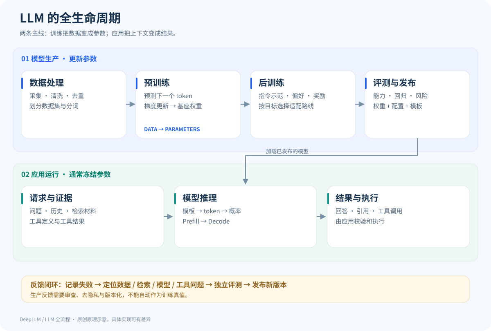

# 01 · 全局地图：先分清模型与系统

[返回目录](README.md) · [下一章：数据与分词 →](02-数据与分词.md)

## 1. 一个 LLM 项目有两段生命周期

**模型生产阶段**把数据变成参数：数据处理 → 预训练 → 后训练 → 评测 → 发布权重。模型可能经历多轮继续训练和评测，SFT 与强化学习也可能交替进行。

**应用运行阶段**把用户输入变成结果：构造上下文 → 模型推理 → 必要的检索或工具执行 → 校验并返回。它使用已训练的参数，通常没有反向传播。

从零训练、基于开放权重微调、调用现有模型服务，是三种不同的项目入口。做内部文档助手通常可以直接从已有模型和 RAG 开始。是否微调，应由任务评测决定。

## 2. 六个容易混淆的对象

| 对象 | 实际是什么 | 在例子中的角色 |
| --- | --- | --- |
| 权重 / 参数 | 训练后保留的数值张量 | 语言与任务能力的主要载体，不是可精确查表的文档库 |
| Tokenizer | 文本与 token ID 之间的转换规则 | 把“申请 GPU”转成整数序列 |
| 上下文 | 当前请求中模型可读取的 token 序列 | 指令、问题、历史、检索文档和工具结果 |
| KV Cache | 当前推理中保存的中间 K/V 张量 | 加速后续 token 生成，不是长期知识记忆 |
| 外部知识库 | 原文、索引和访问权限等 | 保存公司当前申请制度 |
| 应用编排 | 路由、检索、工具、校验和界面代码 | 决定何时查文档、能否提交申请 |

一个可运行的模型包通常需要匹配的权重、结构配置、tokenizer；对话模型还需要正确的聊天模板。仅有一份权重文件并不一定足够复现预期行为。

## 3. 四种“学习”分别改变什么

- **预训练**：用大量序列预测目标更新参数，建立通用能力。
- **微调 / 后训练**：基于已有参数继续优化，改变任务表现、格式或行为偏好。
- **上下文学习**：把示例放进当前提示，参数不变，模型根据上下文完成任务。
- **外部记忆**：把信息写入数据库，下次检索时再送入上下文；这本身不更新模型参数。

对于“公司今天修改了 GPU 申请规则”，更新可检索文档可以让下一次请求使用新规则。若选择微调，则还要准备数据、训练、验证并部署新版本，而且不能保证模型逐字记住规则。

## 4. 全流程中的输入与产物

| 环节 | 输入 | 产物 | 核心验收点 |
| --- | --- | --- | --- |
| 数据处理 | 文档与元数据 | 可追溯的训练集、验证集、测试集 | 质量、授权、去重、无泄漏 |
| 预训练 | token 序列、模型结构 | 基座 checkpoint | 损失趋势、稳定性、基础能力 |
| 后训练 | 指令、示范、偏好或奖励 | 适配后的 checkpoint / adapter | 指令遵循、任务收益、能力回归 |
| 推理部署 | 模型包与硬件资源 | 可调用的服务 | 正确性、并发、延迟、成本 |
| 应用集成 | 请求、知识库、工具 | 有用且可追踪的结果 | 依据、权限、可恢复性 |
| 评测迭代 | 测试集与运行反馈 | 发布决策和改进清单 | 改进可复现，退化可发现 |

## 5. 先建立三个正确直觉

**输出来自条件概率。** 模型根据已有 token 计算下一个 token 的分布，再通过解码策略选出一个。一次回答通常包含许多次这样的选择。

**流畅不代表有依据。** 生成目标不会自动保证每个事实真实。应用需要提供证据，并检查输出是否被证据支持。

**整体效果取决于整条链路。** 若检索到了旧制度，换一个更大的模型也未必解决问题。诊断应分别观察数据、检索、上下文、生成和执行。

自检：如果模型回答了旧规则，可能是训练记忆、旧索引、检索选错版本或上下文截断；应先检查实际送入模型的材料。
