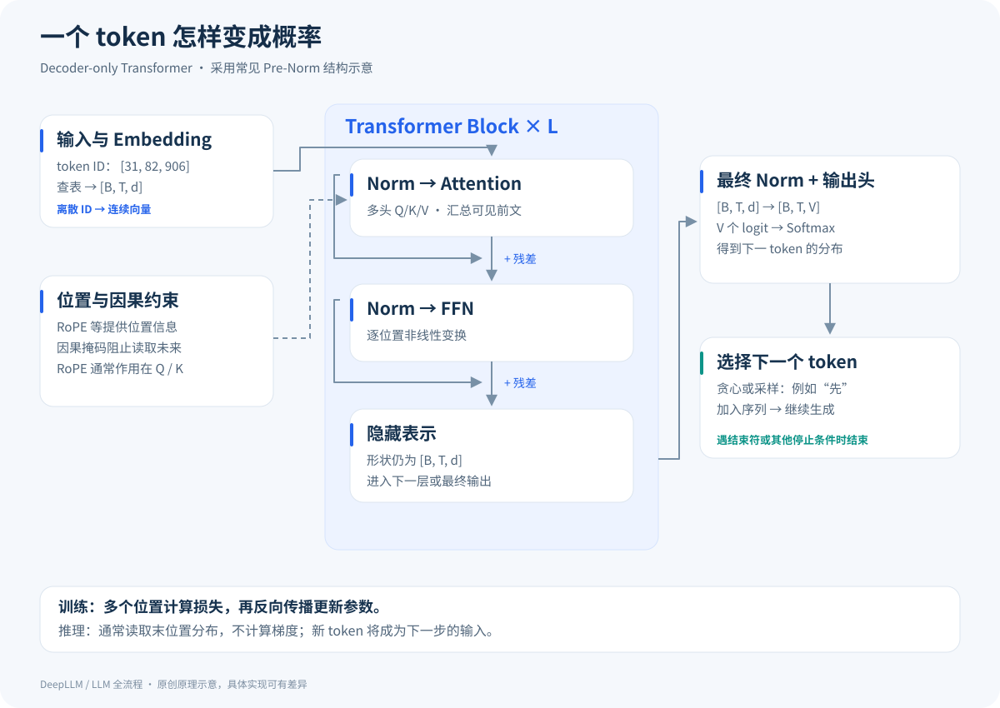

# 03 · 模型内部：从 token 到概率

[← 上一章](02-数据与分词.md) · [返回目录](README.md) · [下一章 →](04-预训练.md)

## 1. 一次前向计算的全貌



设批大小为 `B`、序列长度为 `T`、隐藏维度为 `d`、词表大小为 `V`。这几个符号将贯穿本章。

| 步骤 | 输入 → 输出形状 | 作用 |
| --- | --- | --- |
| 查 Embedding 表 | `[B,T]` → `[B,T,d]` | 把整数 ID 映射成向量 |
| 经过 L 个 Transformer block | `[B,T,d]` → `[B,T,d]` | 融合前文并变换特征 |
| 最终归一化与输出头 | `[B,T,d]` → `[B,T,V]` | 为词表中每个 token 给出 logit |
| Softmax | `[B,T,V]` → 同形状概率 | 得到各位置的条件分布 |

普通续写时，使用最后一个有效位置的分布选择新 token；训练时可以计算多个有效位置的损失。工程实现可能融合输出头与交叉熵，避免显式保存完整概率张量。

## 2. Embedding 与位置

Embedding 是一张可学习的表：第 `i` 行表示 ID 为 `i` 的 token 的初始向量。同一个 token 在这里得到相同的查表结果，经过上下文相关的 Transformer 层后，其隐藏表示会随语境变化。

模型还需要顺序信息。原始 Transformer 使用位置编码；许多后续模型使用 RoPE 等位置方案。RoPE 通常作用于注意力中的 Q/K，而不是简单地把一张位置表加到输入上。详见仓库的 [RoPE](../RoPE.md)。

## 3. Attention：当前位置从哪些前文读取信息

对某层输入表示 `H`，线性投影产生：

$$Q=HW_Q,\qquad K=HW_K,\qquad V=HW_V$$

这里的 `V` 表示 Value 矩阵，不是前文的词表大小；实际代码通常使用不同变量名避免混淆。

单个注意力头计算：

$$\operatorname{Attention}(Q,K,V)=\operatorname{softmax}\left(\frac{QK^\top}{\sqrt{d_k}}+M\right)V$$

- `Q` 是当前位置发出的查询。
- `K` 是各位置用于匹配的键。
- `V` 是匹配后被加权汇总的信息。
- `M` 对未来位置加负无穷，使其概率为零；padding 等约束也可能并入掩码。

Softmax 沿被读取的位置归一化。多头注意力允许不同头学习不同的匹配模式，再合并结果。注意力权重是内部计算量，不能直接当作完整、可靠的因果解释。

生成“申请步骤”时，某些层可能把问题中的“GPU”与前文制度中的相关段落联系起来。但模型没有一个显式保证正确的“事实检索开关”。

## 4. FFN、残差与归一化

Attention 负责跨位置的信息交互；FFN 对每个位置的向量分别执行非线性变换，同层不同位置通常共享 FFN 参数。

基础 FFN 可写为：

$$\operatorname{FFN}(h)=W_2\,\sigma(W_1h+b_1)+b_2$$

现代实现也常见 SwiGLU 等门控变体。MoE 则用路由器选择部分专家网络，详见 [FFN](../FFN.md) 和 [MoE](../Mixture-of-Experts(MoE).md)。

本教程配图采用一种常见的 **Pre-Norm** 顺序：

```text
h'   = h  + Attention(Norm(h))
h''  = h' + FFN(Norm(h'))
```

残差路径让输入与变换结果相加，帮助优化深层网络；归一化调节数值尺度。不同模型可能采用 LayerNorm、RMSNorm 或不同的归一化位置。

## 5. 输出头并不直接产生一句话

输出头把隐藏向量映射为词表 logits，再转成概率：

$$p_i=\frac{\exp(z_i)}{\sum_j\exp(z_j)}$$

模型可能给出“先”“请”“需要”等 token 的不同概率。解码器选一个，加入已有序列，然后继续下一步。若新 token 是结束标记，或达到长度限制等停止条件，生成结束。

同一个前向网络既可用于训练，也可用于推理。区别在于训练还需要损失、梯度和优化器；普通推理只计算输出，不更新参数。

理论来源：[Attention Is All You Need](https://arxiv.org/abs/1706.03762)。原论文包含编码器与解码器；本章使用的是其后发展的 Decoder-only、Pre-Norm 教学结构。
