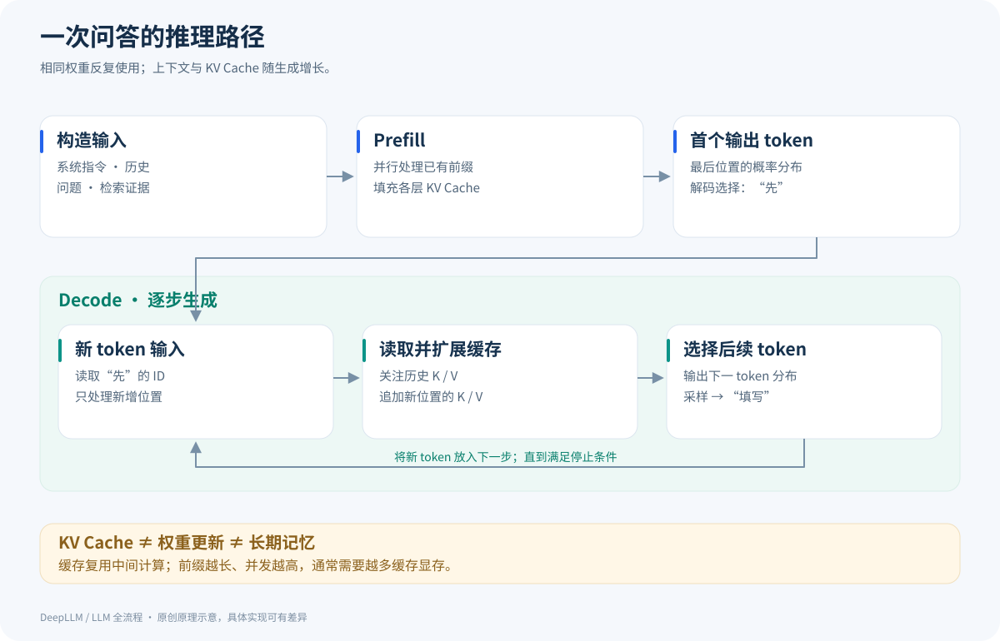

# 06 · 推理与部署：点击发送之后

[← 上一章](05-后训练与适配.md) · [返回目录](README.md) · [下一章 →](07-RAG与工具应用.md)

## 1. 请求先变成一个完整上下文

用户看到的是输入框，模型实际读取的是模板序列化后的 token：

```text
系统指令 + 历史对话 + 检索材料 + 当前问题 + 助手起始标记
```

具体排列与角色取决于模板。应用要保证上下文预算、来源边界与权限。超长历史可能被截断或摘要；摘要会损失信息，截断也可能误删关键规则。

上下文窗口需要容纳输入与后续输出，还受到模型及服务的具体限制。模型支持较长窗口，不等于它能可靠利用其中每一个细节。

## 2. Prefill 与 Decode 是两种计算形态



**Prefill（处理已有前缀）**：对请求中的 token 做前向计算，产生各层 K/V，并取得首个输出 token 的分布。已有前缀的多个位置可以并行计算，仍遵守因果掩码。

**Decode（逐步生成）**：选择一个 token 后，把它作为新的输入，利用缓存计算下一步。单条标准自回归序列的新 token 彼此依赖，通常逐步推进。投机解码等技术可以批量提出并验证候选，但不属于本章基础路径。

## 3. KV Cache 缓存的是什么

每层注意力都需要此前位置的 K/V。缓存它们，可以避免每一步重复计算整个前缀的这些投影。新 token 仍需经过各层、生成自己的 K/V，并关注已有上下文；缓存并不意味着后续计算成本为零。

对标准注意力、统一 KV 头维度，缓存存储量可粗估为：

$$M_{KV}\approx 2\times L\times B\times T\times h_{kv}\times d_{head}\times s$$

`L` 是层数，`B` 是并发序列数，`T` 是每条序列已缓存长度，`h_kv` 是 KV 头数，`s` 是每元素字节数。长度不同时应按实际 token 数求和。这不含分页浪费、元数据和其他运行内存，也不适用于所有压缩缓存架构。

[GQA](../GQA-Attention.md) 通过减少 KV 头数降低缓存规模；[MLA](../Multi-head-Latent-Attention.md) 使用不同的压缩表示，需要按其实现重新计算。

## 4. 从概率中选择 token

- **贪心**：选择概率最高的 token，简单但不保证整段输出最优。
- **Temperature**：常见形式为 `softmax(logits / τ)`，较小的正数通常让分布更集中；服务的 `temperature=0` 常是贪心模式约定。
- **Top-k**：只保留概率最高的 k 个候选再采样。
- **Top-p**：保留累计概率达到阈值的一组高概率候选，再归一化采样。

解码参数影响多样性与稳定性，不能替代证据和事实核验。即使使用贪心，硬件、内核或并行配置变化也可能影响完全一致的复现。

流式输出是在生成过程中逐段返回结果，改善等待体验；它没有改变自回归目标，也不一定缩短总生成时间。

## 5. 部署时优化哪个瓶颈

| 指标 / 手段 | 含义与边界 |
| --- | --- |
| 首 token 延迟（TTFT） | 包括排队、前处理和 prefill 等，口径需明确 |
| 每输出 token 时间（TPOT） | 首 token 后的平均生成耗时，与端到端延迟不同 |
| 吞吐量 | 单位时间处理的 token 或请求，必须附带并发与长度分布 |
| 连续批处理 | 动态接纳与移除序列，提高服务资源利用率 |
| 权重量化 | 减少权重存储或访存成本；收益取决于内核与硬件，需回归评测 |
| 前缀缓存 | 复用相同前缀的计算；需保证匹配条件和租户隔离 |
| 多卡切分 | 容纳更大模型，也会引入通信成本 |

低并发 decode 常受权重访存影响；长上下文、高并发或不同硬件下，瓶颈会变化。应先测量实际请求负载，再选择优化手段。

## 6. 推理上线的最小检查

确认模型、tokenizer、模板及停止符匹配；用真实长度分布检查显存余量和并发；设置输入输出上限、超时与取消；记录延迟、错误率和版本；保留回滚路径。部署可访问，只证明服务接通，还需要下一章的应用链路和最后一章的端到端验证。
