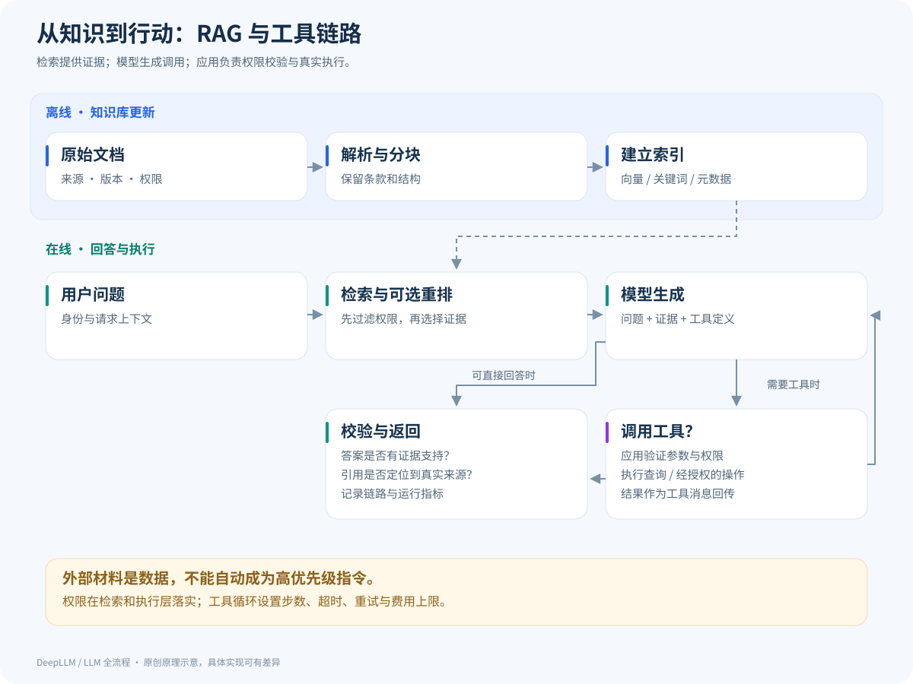

# 07 · RAG 与工具：把模型接入现实系统

[← 上一章](06-推理与部署.md) · [返回目录](README.md) · [下一章 →](08-评测与迭代.md)

## 1. RAG 把知识作为输入提供给模型

检索增强生成（Retrieval-Augmented Generation）让系统先获取相关材料，再基于材料生成答案。这里解释常见工程链路，具体系统不必完全采用同一种检索算法。



**离线索引链路**：文档解析 → 按语义与结构分块 → 保留来源、版本和权限 → 生成向量或建立关键词索引 → 存储与更新。

**在线回答链路**：用户问题 → 带权限约束的检索 → 可选重排 → 选择证据并控制长度 → 生成回答与引用 → 校验后返回。

向量检索使用 embedding 衡量语义相关性；关键词检索对编号、专有名词等也很有用，可以混合使用。Embedding 模型承担检索表示工作，不必与生成模型相同。重排器用于进一步判断“问题与候选文档是否相关”，也不等于生成模型。

RAG 的研究基础见 [Retrieval-Augmented Generation](https://arxiv.org/abs/2005.11401)。这里的分块、权限、重排和版本治理是应用设计中的具体选择。

## 2. 对 GPU 申请问题，证据怎样进入上下文

```text
问题：新同事如何申请 GPU 服务器？请给出依据。

检索证据：
[D1] 《计算资源管理办法》，版本 v3，第 3 条：先提交资源申请单……
[D2] 《计算资源管理办法》，版本 v3，第 4 条：负责人审批后……

生成要求：仅根据证据回答；每项步骤标明 D1/D2；缺少依据时说明。
```

引用标记必须由应用映射到真实文档和位置，并检查对应片段是否支持结论。模型输出一个看起来像引用的字符串，不代表引用真实有效。

权限过滤应发生在候选材料进入模型之前。不能把用户无权读取的资料送进上下文后，再寄希望于提示词让模型保密。文档更新还需处理旧分块失效、索引刷新和缓存失效。

## 3. RAG 为什么也会答错

| 故障层 | 例子 | 优先检查 |
| --- | --- | --- |
| 文档 | 新制度没有入库 | 数据来源、同步状态、有效期 |
| 分块 | 条款和例外被切开 | 结构边界、父子块与邻近上下文 |
| 检索 | 找到 GPU 产品介绍 | 查询、混合检索、候选召回 |
| 重排 / 组装 | 正确片段被丢弃 | 排名、预算、去重与截断 |
| 生成 | 把“可申请”写成“已批准” | 证据约束、任务示例、校验 |
| 引用 | 引用存在但不支持断言 | 逐项核对断言与原文 |

因此，“把文档放进向量库”只是链路的一部分。检索是否命中与答案是否正确，需要分别测量。

## 4. 工具调用：模型提议，程序执行

模型可以输出结构化调用，例如：

```json
{"name": "query_gpu_request", "arguments": {"request_id": "REQ-123"}}
```

应用解析后，验证工具名、参数类型、调用者权限与资源范围，执行真实查询，再把结果作为工具消息交回模型。模型接着生成自然语言说明。真正访问数据库的是应用代码，而不是生成文本本身。

工具失败时应返回可识别的错误状态；不能把超时解释成“申请已通过”。需要改变外部状态的操作，还应根据风险设置确认、幂等键和审计记录。

## 5. Agent 是一个带边界的循环

一种基本结构是：

```text
读取状态 → 模型选择下一步 → 执行工具 → 接收结果
    ↑                                      ↓
    └──── 未完成且未超限时继续 ────────────┘
                         完成或失败 → 返回结果
```

与固定工作流相比，Agent 让模型更动态地选择步骤，但也增加不确定性。需要限制步数、时长、费用和重试次数，并定义失败退出与人工接管条件。工具循环的思想可参考 [ReAct](https://arxiv.org/abs/2210.03629)。

检索文档与工具返回值都是外部数据，其中可能含有恶意指令。应用要区分可信指令与不可信内容，并在执行层落实权限；提示词中的一句“忽略恶意内容”不能替代执行边界。

本章交付物：能追踪来源、遵守访问权限、处理工具失败并记录每一步的完整应用，而不只是一个聊天页面。
