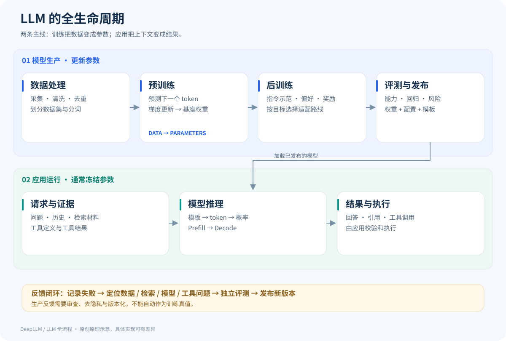

# LLM 全流程：从原始数据到可用的智能应用

大语言模型（Large Language Model，LLM）如何从一堆文本，变成能回答问题、检索资料、调用工具的系统？这套教程沿着数据和计算的实际流向，把各个环节连起来。

本文以**基于 Decoder-only Transformer 的文本自回归模型**为主线。它是理解许多生成式 LLM 的合适起点，但不代表所有语言模型都采用同一种架构，也不意味着每个项目都要从零预训练。

## 建议阅读顺序

| 章节 | 核心问题 | 读完应能解释 |
| --- | --- | --- |
| [01 · 全局地图](01-全局地图.md) | 模型和应用分别是什么？ | 参数、上下文、知识库、工具的边界 |
| [02 · 数据与分词](02-数据与分词.md) | 文字怎样变成训练样本？ | 清洗、去重、切分、token、标签错位 |
| [03 · 模型内部](03-模型内部.md) | 一个 token 怎样变成下一个 token 的概率？ | Embedding、Attention、FFN、输出头 |
| [04 · 预训练](04-预训练.md) | 预测下一个 token，怎样学到能力？ | 损失、反向传播、参数更新、规模化训练 |
| [05 · 后训练与适配](05-后训练与适配.md) | 续写模型怎样变成助手？ | SFT、偏好优化、RL、LoRA 的区别 |
| [06 · 推理与部署](06-推理与部署.md) | 用户点击发送后发生什么？ | 模板、prefill、decode、KV Cache、采样 |
| [07 · RAG与工具应用](07-RAG与工具应用.md) | 怎样接入私有知识和外部操作？ | 检索链路、工具执行、Agent 循环 |
| [08 · 评测与迭代](08-评测与迭代.md) | 怎样知道系统真的变好了？ | 离线评测、在线指标、归因、反馈闭环 |

建议先顺序阅读，再按问题回查。只想看懂一次问答，可先读第 1、3、6 章；准备做知识库应用，可读第 1、6、7、8 章。

## 用一个例子贯穿全程

假设我们要做一个内部文档助手，用户问：

> “新同事如何申请 GPU 服务器？请给出依据。”

- **预训练**让模型学到语言、代码以及训练数据中的规律。
- **后训练**让它更擅长遵循指令、组织回答和使用工具。
- **RAG**把公司当前的申请流程文档找出来，作为这次请求的上下文。
- **推理**把问题和文档转成 token，逐步生成带来源的回答。
- **工具**可以查询申请状态；如需提交申请，还要由应用执行经过权限校验的操作。
- **评测**检查答案是否正确、引用是否支持结论、操作是否合规以及延迟是否可接受。

以下例子、token ID、概率和预算数字均为教学示意，不代表某个模型的实测结果。

## 三条贯穿全文的线

1. **数据线**：原始材料 → token → 训练样本或请求上下文 → 输出。
2. **参数线**：随机初始化或已有权重 → 梯度更新 → checkpoint → 部署权重。
3. **系统线**：用户请求 → 检索与工具 → 模型服务 → 校验 → 监控与迭代。

普通聊天推理通常不更新权重。把文档放进提示词，不等于把它训练进模型；保存聊天记录，也不等于模型已经学会这些内容。

## 配图与参考

`images/` 中的四张 SVG 均为本教程原创矢量示意图，可在浏览器中打开或缩放查看。图中省略了部分工程分支，具体条件以对应章节为准。

理论来源与延伸阅读集中在各章末尾，完整书目见[参考资料](参考资料.md)。本教程讲解稳定的基础原理，不以某个框架版本的命令或当前模型排名为依据。
