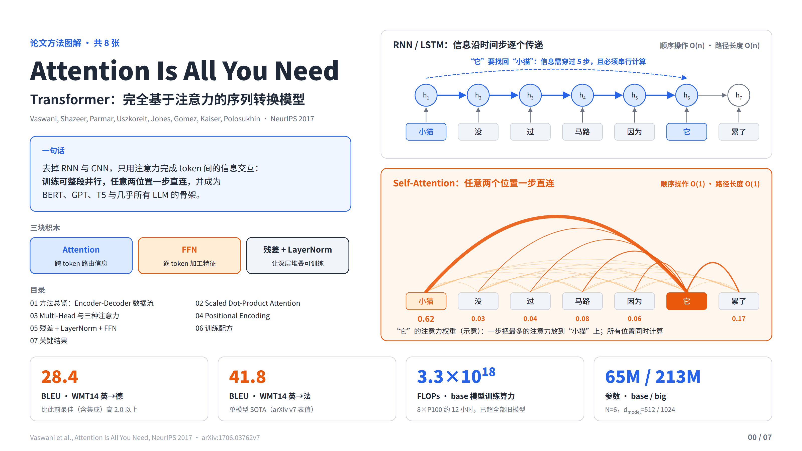
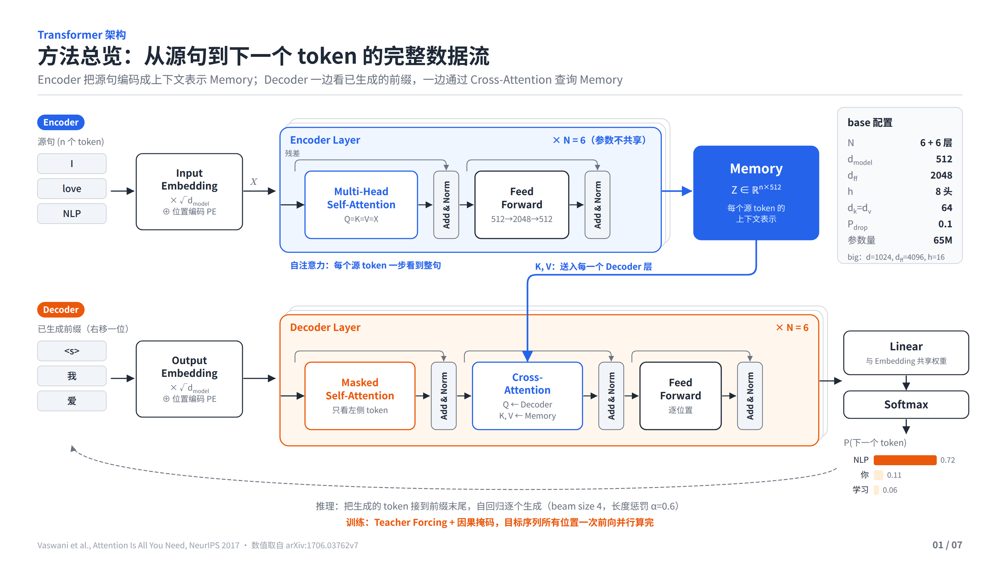
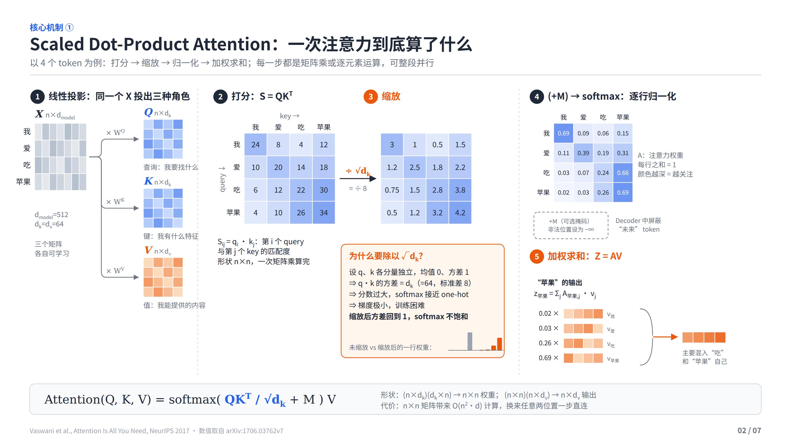
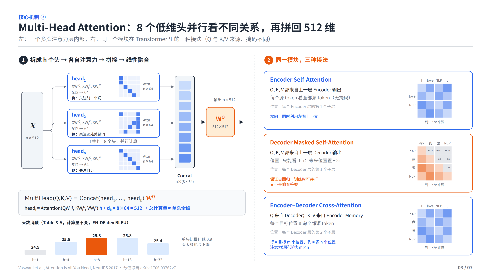
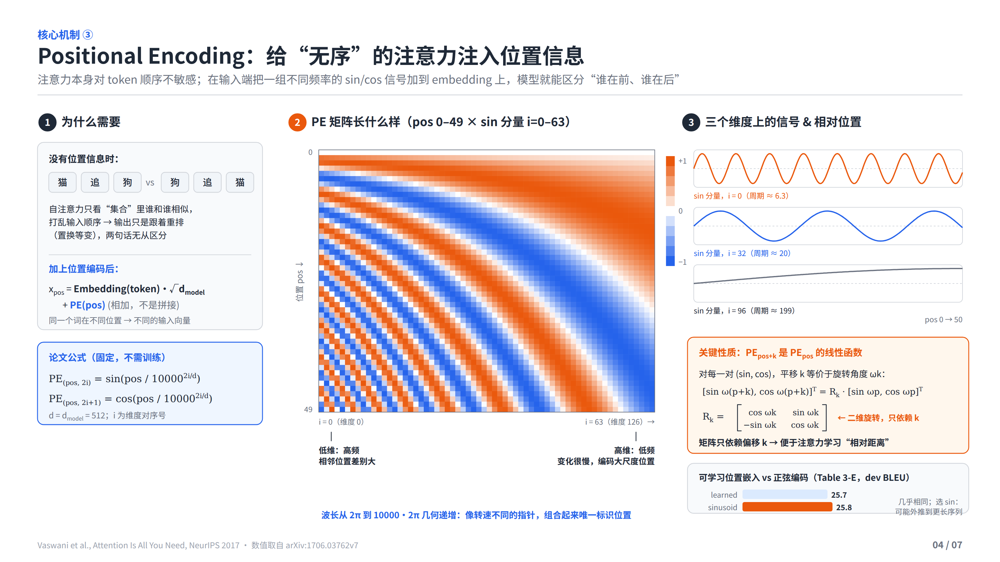
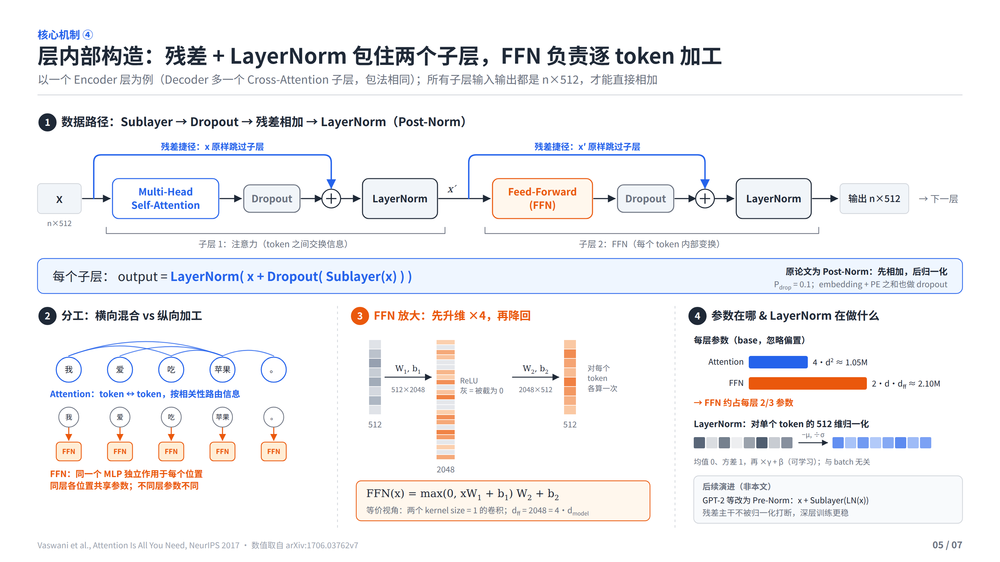
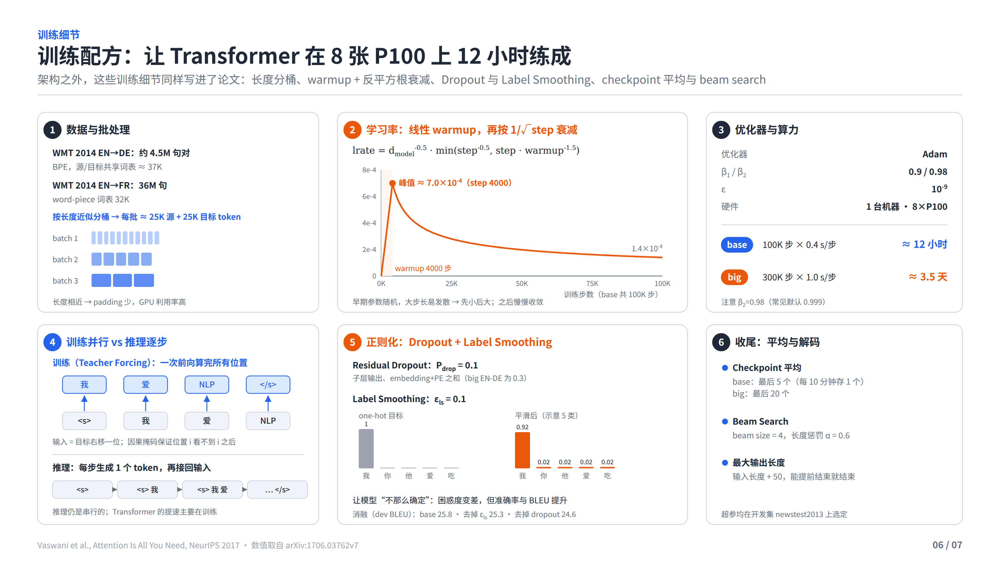
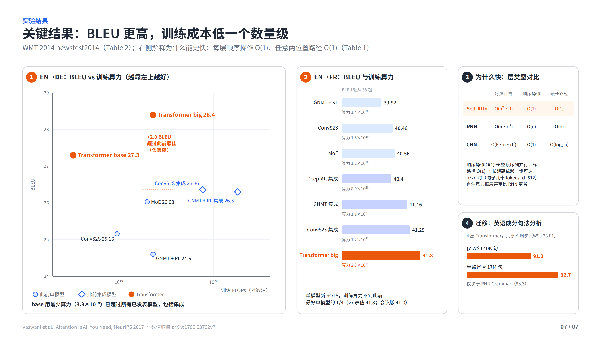

# Attention Is All You Need — 图解

## 论文信息

- 论文：[arXiv:1706.03762v7](https://arxiv.org/abs/1706.03762v7) · 本地 PDF：[Attention_Is_All_You_Need_arXiv_v7.pdf](../Attention_Is_All_You_Need_arXiv_v7.pdf)
- 配套导读：[Transformer 原理导读](../00_Transformer_2017_原理.md)
- 风格：paper-figure（16:9，3200×1800）
- 页数：8（封面 + 7 页）
- 实验数值取自 arXiv v7；EN→FR big 在 2017 会议版为 41.0，v7 表格为 41.8
- 图源码：`src/`（Python 生成 SVG，headless Chrome 渲染）。修改后执行 `cd src && python3 figXX_*.py` 即可重新出图

## 封面

**一句话**：Transformer 去掉 RNN 与 CNN，只靠注意力在 token 之间交换信息，所以训练能整段并行，任意两个位置一步直连。它后来成为 BERT、GPT、T5 和几乎所有 LLM 的骨架。封面右侧用同一句话对比两种结构：在 RNN 里，“它”要穿过 5 步才能连到“小猫”；在 Self-Attention 里只需一步。

## 第 1 页：方法总览

**讲解**：上下两行分别是 Encoder 和 Decoder。源句经 Embedding（×√d_model）加上位置编码后，通过 6 个 Encoder 层，输出 Memory。Decoder 的输入是右移一位的目标前缀，每层依次经过 Masked Self-Attention、Cross-Attention（Q 来自 Decoder，K/V 来自 Memory）和 FFN，每个子层外面都包着残差 + LayerNorm。最后经 Linear（与 Embedding 共享权重）和 Softmax 得到下一个 token 的分布。重点看 Memory 那条蓝色箭头：它送入**每一个** Decoder 层，而不只是第一层。

## 第 2 页：Scaled Dot-Product Attention

**讲解**：用 4 个 token 走一遍完整计算。X 先投影成 Q、K、V；QKᵀ 得到 n×n 的匹配分数；除以 √d_k（=8）；可选加掩码 M；逐行 softmax 得到权重 A；最后用 A 对 V 加权求和。橙色框解释为什么要缩放：q·k 的方差等于 d_k，不缩放的话 softmax 会接近 one-hot，梯度几乎消失。右下角拆开了“苹果”这一行的输出，它主要混入了“吃”和它自己的 V。

## 第 3 页：Multi-Head Attention 与三种注意力

**讲解**：左边是多头注意力：把 512 维投影成 8 个 64 维的头，各自做注意力后拼接，再乘 W^O。因为 h·d_k = 512，总计算量和单头全维注意力相当。头数消融（Table 3-A）中，单头比最佳低 0.9 BLEU，头太多也会下降。右边是同一个模块的三种接法，区别只在 Q 和 K/V 的来源以及掩码：Encoder 自注意力是双向的；Decoder 自注意力用因果掩码（未来位置置为 −∞）；Cross-Attention 的权重矩阵形状是 m×n（目标 × 源）。

## 第 4 页：Positional Encoding

**讲解**：自注意力是置换等变的，“猫追狗”和“狗追猫”在它看来是同一组 token，所以必须把位置信息加进输入。中间的热力图按论文公式真实计算，展示 sin 分量：低维频率高，高维频率低，波长从 2π 几何增长到 10000·2π。右侧给出关键性质：PE(pos+k) 是 PE(pos) 的一个旋转，旋转矩阵只依赖 k，便于模型学习相对位置。可学习的位置嵌入和正弦编码效果几乎相同（25.7 vs 25.8 dev BLEU），论文选正弦，是希望能外推到更长的序列。

## 第 5 页：残差 + LayerNorm + FFN

**讲解**：每个子层都按 `LayerNorm(x + Dropout(Sublayer(x)))` 包装，这是原论文的 Post-Norm。两个子层分工不同：Attention 在 token 之间横向混合信息，FFN 在每个 token 内部纵向加工（512→2048→512，各位置共享参数）。按参数量算，FFN 约 2.1M，Attention 约 1.05M，FFN 占每层约 2/3。右下角补充了后来的演变：GPT-2 等模型改用 Pre-Norm（不属于本文内容）。

## 第 6 页：训练配方

**讲解**：数据按长度分桶，每批约 25K 源 token + 25K 目标 token。学习率先线性 warmup 4000 步，到峰值约 7×10⁻⁴，然后按 1/√step 衰减（曲线按论文公式计算）。优化器用 Adam，β₂=0.98。训练时用 Teacher Forcing 加因果掩码，一次前向算完所有位置；推理仍是逐 token 串行。正则化用 Dropout 0.1 和 Label Smoothing 0.1：去掉 label smoothing 后 dev BLEU 为 25.3，去掉 dropout 后为 24.6，base 为 25.8。收尾阶段做 checkpoint 平均，解码用 beam 4、α=0.6。

## 第 7 页：关键结果

**讲解**：左图横轴是训练算力（对数轴），纵轴是 EN→DE BLEU。Transformer base 用的算力最少（3.3×10¹⁸），却已经超过此前所有模型，包括集成模型；big 达到 28.4，比此前最佳高 2.0 以上。EN→FR 上，big 以约 1/50 的集成模型算力得到 41.8。右侧用 Table 1 解释为什么快：自注意力每层只需 O(1) 次顺序操作，最长路径也是 O(1)。迁移到英语成分句法分析时，几乎不调参也能达到 91.3 / 92.7 F1。

## 总结：3 个核心要点

1. **注意力即路由**：`softmax(QKᵀ/√d_k + M)V` 让任意两个位置一步交换信息；多头把这种交换拆到多个子空间并行进行；掩码决定谁能看到谁。
2. **积木化堆叠**：Attention（token 之间）+ FFN（token 内部）+ 残差/LayerNorm（可训练性）组成一个标准层；位置信息只在输入端通过 PE 注入一次。
3. **并行带来规模**：去掉循环后，训练每层只需 O(1) 次顺序操作，用更少算力达到更高的 BLEU。这正是后来模型能一路扩展到大模型的前提。
