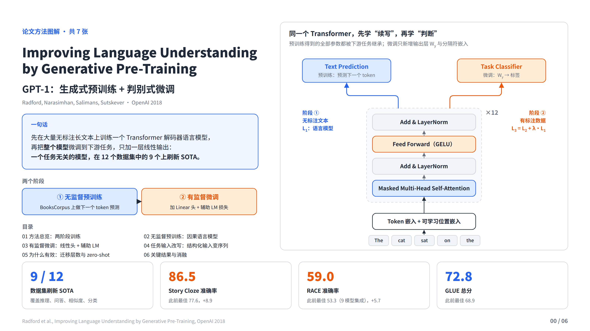
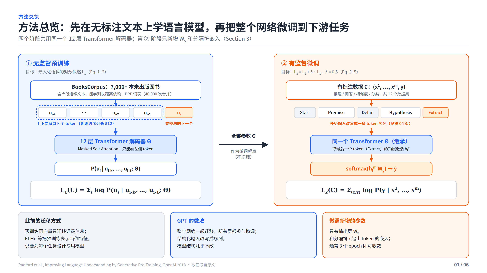
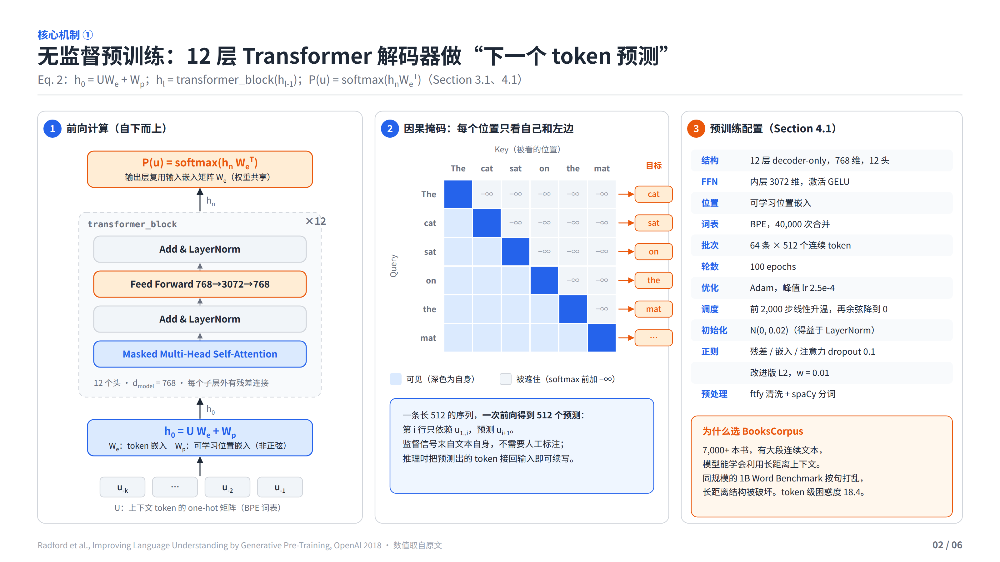
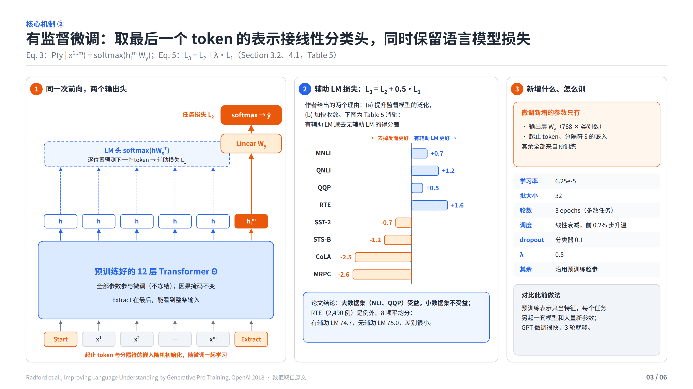
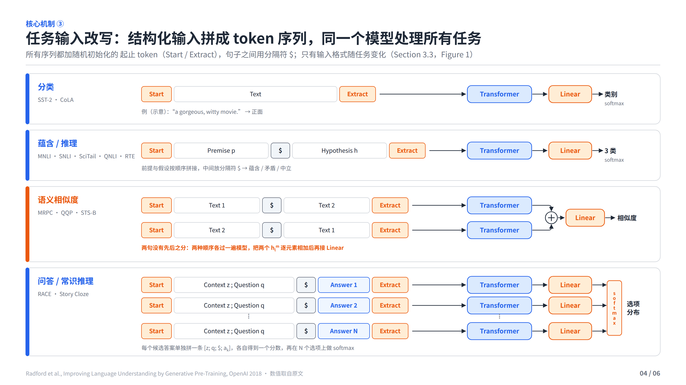
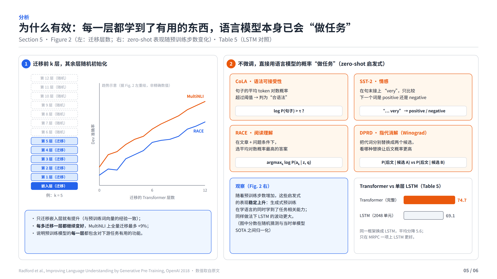
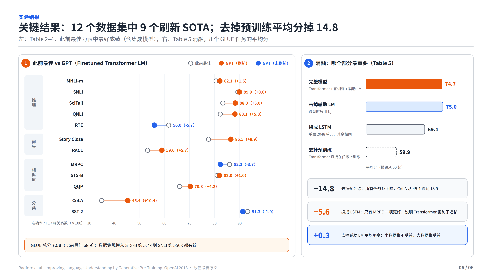

# Improving Language Understanding by Generative Pre-Training — 图解

## 论文信息

- 论文：[OpenAI 论文 PDF](https://cdn.openai.com/research-covers/language-unsupervised/language_understanding_paper.pdf) · 本地 PDF：[Improving_Language_Understanding_by_Generative_Pre-Training.pdf](../Improving_Language_Understanding_by_Generative_Pre-Training.pdf)
- 配套导读：[GPT-1 原理导读](../02_GPT_2018_原理.md)
- 风格：paper-figure（16:9，3200×1800），与 [Transformer 图解](../../00_Transformer_2017/illustrated/transformer-illustrated.md)一致
- 页数：7（封面 + 6 页）
- 实验数值取自原文 Table 2–5；第 05 页左侧曲线是按 Figure 2 趋势重绘的示意，不是精确数值
- 图源码：`src/`（Python 生成 SVG，headless Chrome 渲染）。修改后执行 `cd src && python3 figXX_*.py` 即可重新出图

## 封面

**一句话**：GPT-1 先在无标注的长文本上训练一个 Transformer 解码器语言模型，再把整个网络微调到下游任务，只新增一层线性输出。一个任务无关的模型在 12 个数据集中的 9 个上刷新 SOTA。右侧画的是论文 Figure 1 的思路：同一个 12 层主干，预训练时接“Text Prediction”头，微调时接“Task Classifier”头。

## 第 1 页：方法总览

**讲解**：左边是阶段 ①：在 BooksCorpus 上用前 k 个 token 预测下一个 token，最大化对数似然 L₁。右边是阶段 ②：把有标注样本改写成一条 token 序列，送进同一个 Transformer，取最后一个 token（Extract）的顶层激活 h_l^m，乘 W_y 后做 softmax 得到标签。两阶段之间传递的是**全部参数 Θ**，微调时不冻结任何层。底部三张卡片对比了此前的迁移方式：此前要么只迁移词向量，要么把预训练表示当特征、再为每个任务设计专用模型；GPT 迁移整个网络，只改输入格式。

## 第 2 页：无监督预训练

**讲解**：左栏按 Eq. 2 自下而上走一遍：token 嵌入 W_e 加可学习位置嵌入 W_p 得到 h₀，经过 12 个 transformer_block，最后用 W_eᵀ 投影回词表做 softmax，输入嵌入和输出层共享同一个矩阵。中栏是因果掩码：第 i 行只能看到位置 1..i，右上三角在 softmax 前加 −∞，所以一条 512 长的序列一次前向就能得到 512 个“预测下一个词”的训练信号。右栏是 Section 4.1 的完整配置（768 维、12 头、FFN 3072、GELU、BPE 40k、Adam 2.5e-4、warmup 2000 步加余弦退火、100 epochs）。选 BooksCorpus 是因为它有大段连续文本，而同规模的 1B Word Benchmark 按句打乱，长距离结构已被破坏。

## 第 3 页：有监督微调

**讲解**：左栏展示同一次前向的两个输出：Extract 位置的 h_l^m 接 W_y 算任务损失 L₂；其余位置照常预测下一个 token，得到辅助语言模型损失 L₁，总目标为 L₃ = L₂ + 0.5·L₁。中栏用 Table 5 检验辅助损失：MNLI、QNLI、QQP、RTE 上有帮助，CoLA、MRPC、STS-B、SST-2 上去掉反而更好，8 项平均分为 74.7 对 75.0，差别很小。论文的结论是大数据集受益、小数据集不受益（RTE 是例外）。右栏列出微调新增的参数（只有 W_y 和起止、分隔符嵌入）与超参：lr 6.25e-5、batch 32、多数任务 3 个 epoch。

## 第 4 页：任务输入改写

**讲解**：预训练模型只见过连续文本，因此论文不改模型结构，而是把结构化输入“拍平”成序列，即 traversal-style 的做法。分类直接用 `[Start; Text; Extract]`；蕴含把前提和假设用 `$` 拼接；相似度因为两句没有先后之分，两种顺序各过一遍模型，把两个 h_l^m 逐元素相加后再接 Linear；问答 / 多选为每个候选答案单独拼一条 `[z; q; $; a_k]`，各得一个分数，再在 N 个选项上做 softmax。BERT 的 `[CLS] A [SEP] B` 输入格式沿用的也是这个思路。

## 第 5 页：为什么有效

**讲解**：左栏对应 Figure 2 左图：只迁移前 k 层、其余层随机初始化时，迁移的层数越多，RACE 和 MultiNLI 的表现越好；在 MultiNLI 上，全量迁移最多带来 9% 的提升。这说明预训练模型的每一层都包含有用的功能。右栏是四个 zero-shot 启发式，都不做任何微调、直接读语言模型的概率：CoLA 对平均对数概率设阈值，SST-2 在句末接 “very” 再比较 positive 和 negative 的概率，RACE 选条件概率最高的答案，DPRD 比较代词替换成不同候选后的后文概率。随着预训练步数增加，这些启发式的表现稳定上升。换成 LSTM 后平均分降 5.6，zero-shot 表现的波动也更大。

## 第 6 页：关键结果

**讲解**：左图比较 12 个数据集上此前最佳成绩（空心圆，含集成模型）与 GPT（实心圆）。橙色是刷新的 9 项，提升最大的是 CoLA（+10.4）、Story Cloze（+8.9）、QNLI（+5.8）和 RACE（+5.7）。蓝色是未刷新的 3 项：RTE、MRPC 和 SST-2，其中 RTE 只有 2,490 个样本。GLUE 总分为 72.8，此前最佳为 68.9。右图是消融：去掉预训练平均分降 14.8，影响最大，例如 CoLA 从 45.4 跌到 18.9；换成 LSTM 降 5.6；去掉辅助 LM 平均分反而略高 0.3。

## 总结：3 个核心要点

1. **生成式预训练学到可迁移的通用表示**：只靠“预测下一个 token”，模型在无标注长文本上学到了语言知识和长距离依赖。消融显示，这一步的贡献最大（+14.8）。
2. **迁移整个网络，而不是只迁移特征**：微调时所有层都继承、都更新，只新增 W_y 和分隔符嵌入；不同任务的差别只体现在输入格式上。这确立了“预训练 + 微调”的通用范式。
3. **Transformer 解码器是更好的迁移载体**：与 LSTM 相比，它能利用更长的上下文，迁移效果更好，zero-shot 行为也更稳定。GPT-2 和 GPT-3 沿着同一架构继续扩大规模，并逐步去掉微调这一步。
