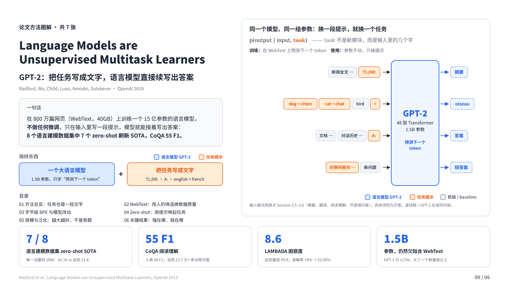
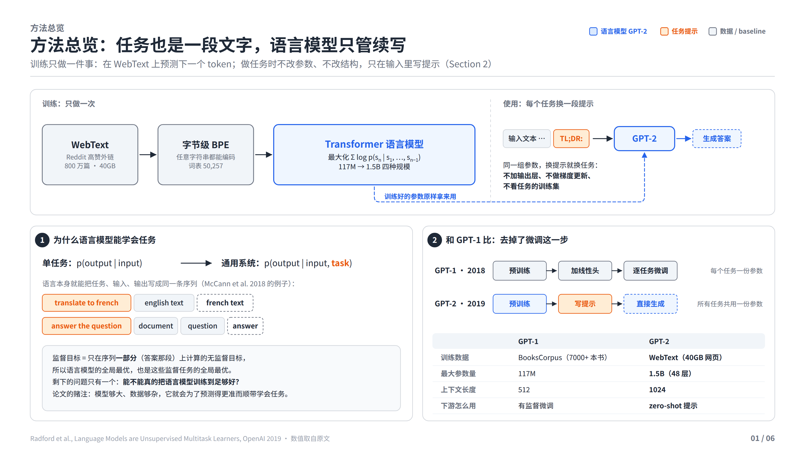
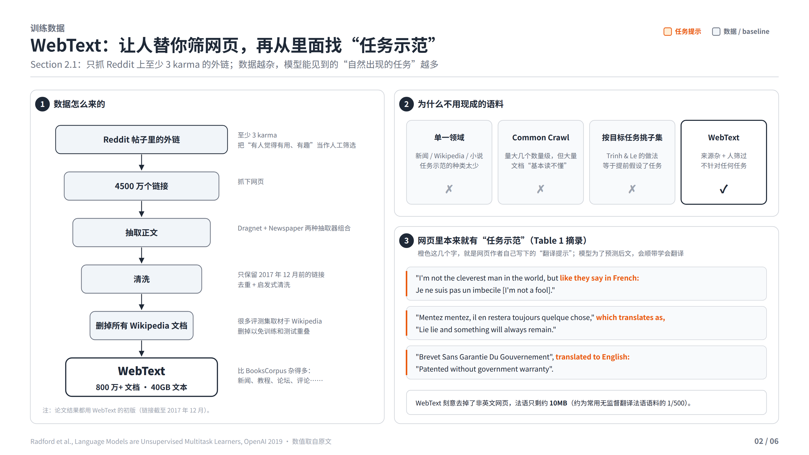
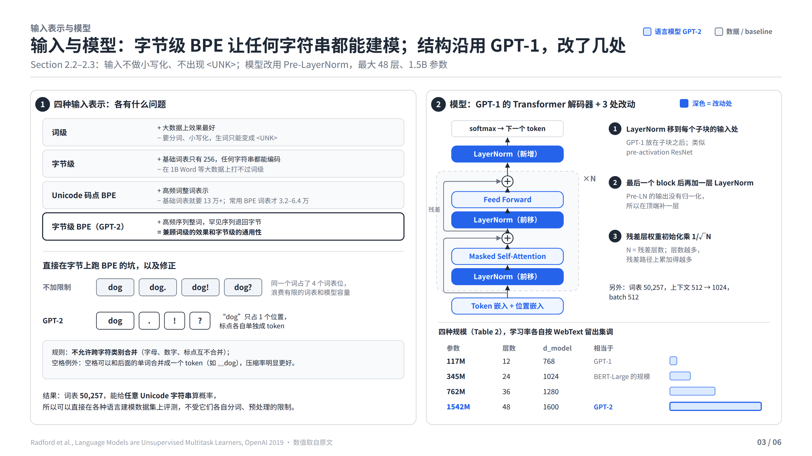
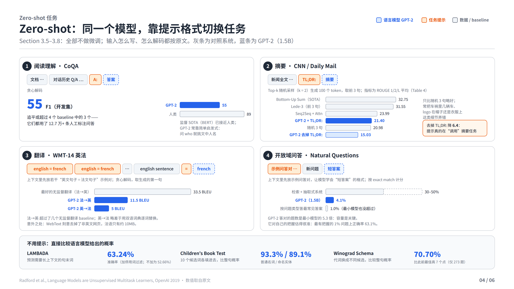
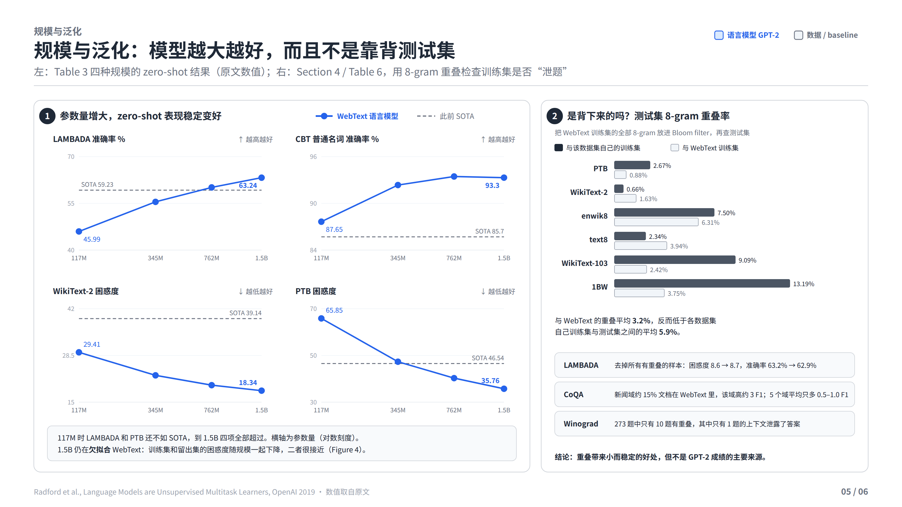
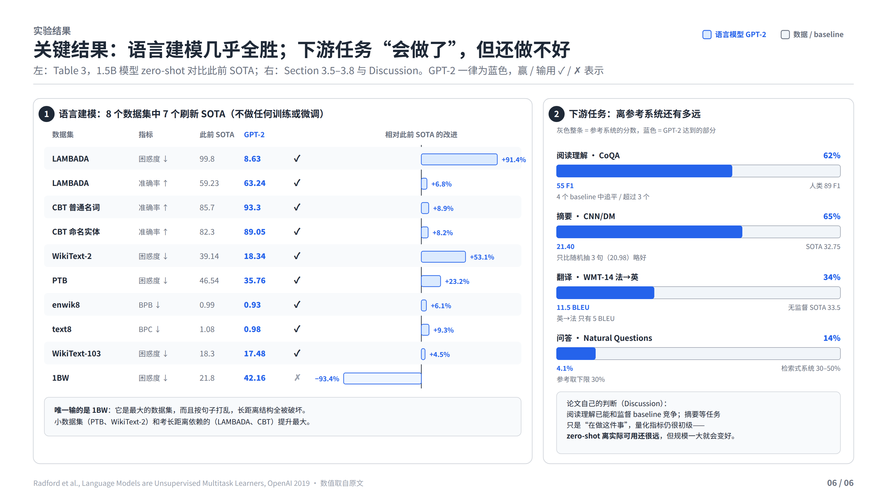

# Language Models are Unsupervised Multitask Learners — 图解

## 论文信息

- 论文：[OpenAI 论文 PDF](https://cdn.openai.com/better-language-models/language_models_are_unsupervised_multitask_learners.pdf) · 本地 PDF：[Language_Models_are_Unsupervised_Multitask_Learners.pdf](../Language_Models_are_Unsupervised_Multitask_Learners.pdf)
- 配套导读：[GPT-2 原理导读](../../03_GPT2_2019_原理.md)
- 风格：paper-figure（16:9，3200×1800），与 [GPT-1 图解](../../02_GPT_2018/illustrated/gpt1-illustrated.md)一致
- 页数：7（封面 + 6 页）
- 颜色（整组统一）：**蓝 = 语言模型 GPT-2**（模型本体、它的预测和结果）；**橙 = 任务提示**（写成文字的任务，如 `TL;DR:`、`A:`、`english = french`）；**灰 = 数据、输入、baseline / 此前 SOTA**。是否刷新 SOTA 用 ✓ / ✗ 表示，不占颜色。线型：蓝色虚线框 = GPT-2 生成的内容；灰色虚线框 = 数据样例里的答案位置（不是模型生成的）。GPT-1 作为对照方法用灰色
- 数值均取自原文 Table 1–6 与正文；第 05 页的曲线是 Table 3 四种规模的原始数值，不是按图重绘
- 图源码：`src/`（Python 生成 SVG，headless Chrome 渲染）。修改后执行 `cd src && python3 figXX_*.py` 即可重新出图

## 封面

**一句话**：GPT-2 在 800 万篇网页（WebText，40GB）上训练一个 15 亿参数的语言模型，不做任何微调，只在输入里写一段提示，模型就能续写出答案。在 8 个语言建模数据集中，它 zero-shot 刷新了 7 个的 SOTA；在 CoQA 阅读理解上达到 55 F1。右侧画的是核心思路：同一个模型、同一组参数，提示换成 `TL;DR:`、若干组“英文 = 法文”、`A:` 或示例问答对，任务就随之切换为摘要、翻译、阅读理解或开放域问答。输入格式按原文，具体词句为示意；虚线框是 GPT-2 生成的内容。底部 4 张数字卡都附了对照：1BW 是唯一没赢的数据集，CoQA 对照人类 89 F1，LAMBADA 对照此前的 99.8，参数量对照 GPT-1 的 117M。

## 第 1 页：方法总览

**讲解**：上半部分是完整流程。训练只做一次：WebText 经过字节级 BPE 编码，送进 Transformer，目标只有“预测下一个 token”。使用时不加输出层、不做梯度更新、不看任务的训练集，只在输入里写提示。左下解释为什么这可行：通用系统要建模 p(output | input, task)，而语言本身就能把任务、输入、输出写成同一条序列。监督目标等于只在答案那段上计算的无监督目标，所以语言模型的全局最优也是监督任务的全局最优；剩下的问题只是能不能把语言模型训得足够好。右下对比 GPT-1：GPT-2 去掉了“加线性头 + 逐任务微调”，换成“写提示 + 直接生成”，并把数据、参数和上下文长度都放大了。

## 第 2 页：WebText

**讲解**：左边是数据流程：只抓 Reddit 上至少 3 karma 的外链，相当于用读者的反应做人工筛选；4500 万个链接经正文抽取、去重和清洗，再删掉所有 Wikipedia 文档（避免和测试集重叠），得到 800 万+ 文档、40GB 文本。右上说明为什么不用现成语料：单一领域的语料里任务示范太少；Common Crawl 量大但质量差；按目标任务挑子集则等于提前假设了任务。右下是 Table 1 的摘录：网页作者自己写下的“like they say in French:”“translated to English:”，本身就是翻译提示。模型为了预测后文，会顺带学会翻译，尽管 WebText 里法语只有约 10MB。

## 第 3 页：输入表示与模型

**讲解**：左栏比较四种输入表示。词级要分词，生词会变成 `<UNK>`；字节级什么都能编码，但效果差；按 Unicode 码点做 BPE，基础词表就要 13 万+。GPT-2 在字节上做 BPE，基础词表只有 256；为了不让 `dog.`、`dog!`、`dog?` 各占一个词表位，规定不同字符类别之间不合并，空格例外。最终词表为 50,257，能给任意字符串算概率，所以可以直接在各种数据集上评测。右栏是模型：沿用 GPT-1 的 Transformer 解码器，深蓝色是三处改动：LayerNorm 移到子块输入处（Pre-LN）、最后一个 block 后再加一层 LayerNorm、残差层初始化乘 1/√N。此外上下文从 512 增加到 1024，batch 为 512。四种规模从 117M（相当于 GPT-1）到 1542M（GPT-2）。

## 第 4 页：Zero-shot 怎么唤起任务

**讲解**：每张卡片上方是原文的输入格式，橙色是提示。阅读理解在文档和对话历史后接 `A:`，得到 55 F1，追平或超过 4 个 baseline 中的 3 个，而这些 baseline 用了 12.7 万+ 条标注问答。摘要在文章后接 `TL;DR:`，ROUGE 平均 21.40，只比随机抽 3 句略好；但去掉 `TL;DR:` 会降 6.4，说明提示确实在调用摘要任务。翻译先放几组“英文 = 法文”示例，法→英 11.5 BLEU，英→法 5 BLEU。开放域问答先放示例问答对，exact match 为 4.1%，是最小模型的 5.3 倍；在最有把握的 1% 问题上正确率达 63.1%。底部三项不需要提示，直接比较概率：LAMBADA 63.24%、CBT 93.3% / 89.1%、Winograd 70.70%。

## 第 5 页：规模与泛化

**讲解**：左边四张小图用 Table 3 的原始数值画出：从 117M 到 1.5B，各项结果稳定变好。117M 时 LAMBADA 和 PTB 还不如 SOTA，到 1.5B 四项全部超过；而且 1.5B 仍在欠拟合 WebText（Figure 4）。右边回答“是不是背题”：用 Bloom filter 存下 WebText 的全部 8-gram，测试集与 WebText 的重叠平均 3.2%，反而低于各数据集自己训练集与测试集之间的 5.9%。在 LAMBADA 上去掉所有有重叠的样本，困惑度只从 8.6 变为 8.7。结论是重叠带来小而稳定的好处，但不是成绩的主要来源。

## 第 6 页：关键结果

**讲解**：左表是 Table 3 中 1.5B 模型与此前 SOTA 的对比，条形表示相对改进。LAMBADA 困惑度从 99.8 降到 8.63，WikiText-2 改进 53%。唯一输掉的是 1BW：它是最大的数据集，而且按句子打乱，长距离结构已被破坏。右栏把下游任务和参考系统放在一起：阅读理解达到人类水平的 62%，摘要为 SOTA 的 65%，翻译为无监督 SOTA 的 34%，问答约为检索式系统下限的 14%。论文自己的判断是：zero-shot 离实际可用还很远，但规模一大就会变好。

## 总结：3 个核心要点

1. **任务也可以写成文字**：p(output | input, task) 里的 task 不需要新模块，提示几个字就能把同一个语言模型切换到摘要、翻译或问答。去掉 `TL;DR:`，摘要分数降 6.4。
2. **数据要杂，还要有人筛过**：WebText 用 Reddit karma 做质量过滤，覆盖足够多的领域，网页里天然出现的“任务示范”就是模型学会任务的来源。
3. **规模是关键变量**：各项结果随参数量稳定提升，1.5B 仍在欠拟合。GPT-3 沿着这条路线继续放大，并把“在提示里放示例”发展成 few-shot。
